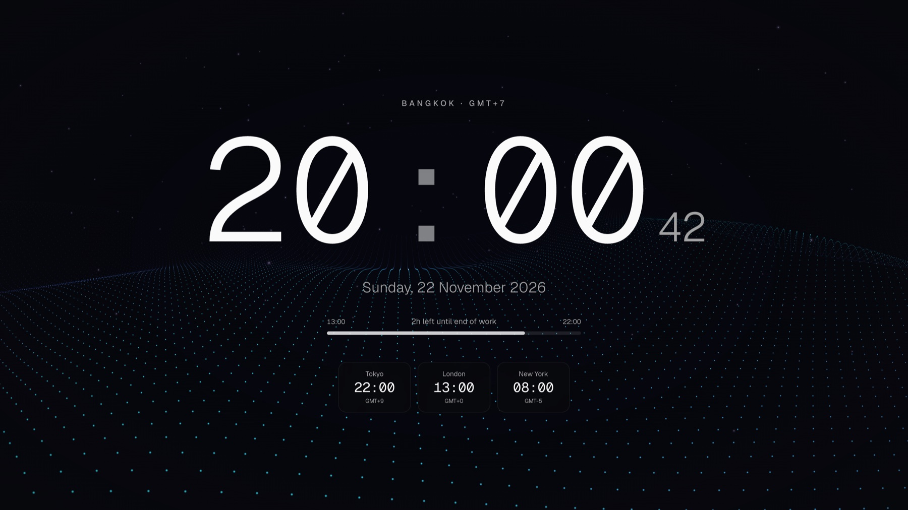
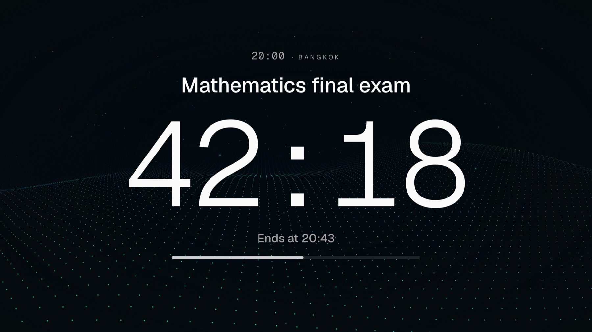
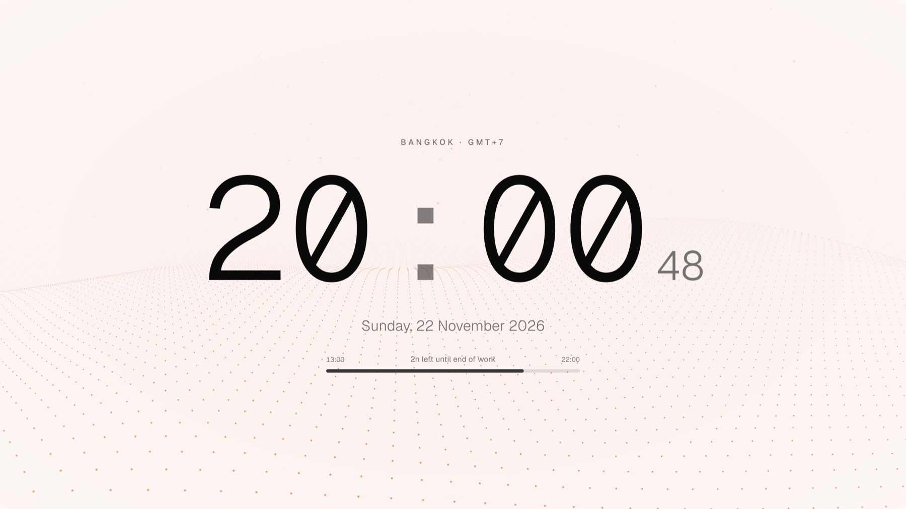
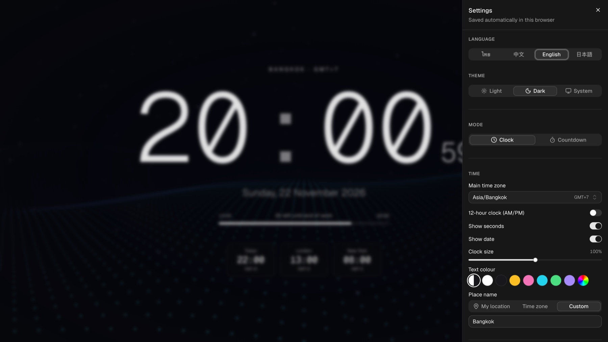
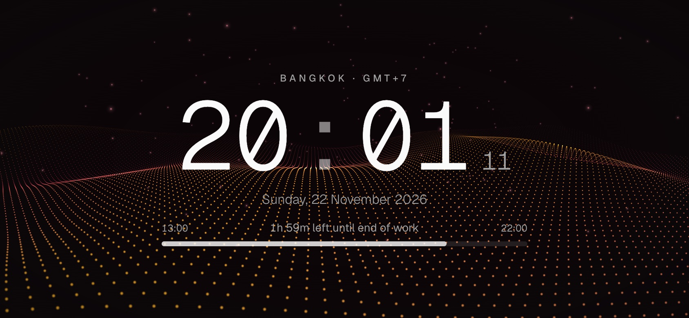
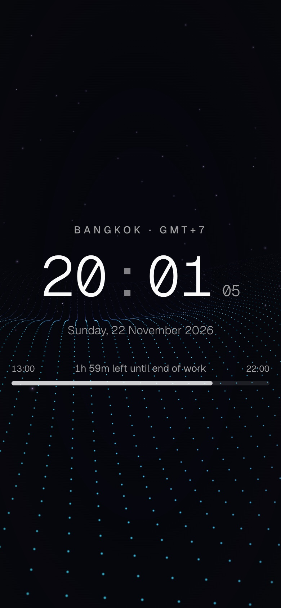

# Nalika

*Nalika* (นาฬิกา) means "clock" in Thai.

A full-screen clock to keep open while you work — or on the projector during an exam. Next.js 16 + shadcn/ui + Three.js (React Three Fiber). No login; all settings live in `localStorage`.

**Live:** https://workclock-psi.vercel.app — free to use, no sign-up, no ads.



<table>
  <tr>
    <td width="50%"><br><sub><b>Countdown</b> — big timer, small wall clock</sub></td>
    <td width="50%"><br><sub><b>Light theme</b> — sunset palette</sub></td>
  </tr>
  <tr>
    <td width="50%"><br><sub><b>Settings</b> — language, theme, time zone, colours</sub></td>
    <td width="50%"><br><sub><b>Phone, landscape</b></sub></td>
  </tr>
</table>

<p align="center"><br><sub><b>Phone, portrait</b></sub></p>

## Features
- Large clock + date for any time zone, plus up to 6 extra cities
- Place name from your location by default (e.g. "Ratchaburi"), or the time-zone city, or your own text
- **Countdown mode** — pick hours/minutes or a preset, big timer with amber/red warnings and an alarm
- Work-hours progress bar with custom title and texts (`{left}` `{start}` `{end}`) — handy for exam proctoring
- Languages: ไทย / 中文 / English / 日本語 (UI and date format)
- Backgrounds: animated 3D wave scene (4 palettes), your own image with motion effects, or a live camera pixel grid
- Dark / Light / System theme, custom text colour, adjustable clock and progress size
- Spotify "now playing" card
- Works on phones in portrait and landscape; fullscreen; controls auto-hide after 3 s

Shortcuts: `F` fullscreen · `S` settings · `T` toggle theme · `C` clock/countdown · `Space` pause/resume countdown

## Run
```bash
npm install
npm run dev
```
Open http://localhost:3000

## Spotify "now playing"
Runs fully in the browser (OAuth Authorization Code + PKCE, no backend, no client secret). Tokens are kept in `localStorage`.

1. Go to https://developer.spotify.com/dashboard → **Create app** (select *Web API*).
2. Add Redirect URI **`http://127.0.0.1:3000/`** — Spotify no longer accepts `localhost`, so open the app at `http://127.0.0.1:3000` too. For a deployed site use `https://your-domain/`.
3. Put the **Client ID** in `.env.local` as `NEXT_PUBLIC_SPOTIFY_CLIENT_ID` (see `.env.example`). In CI it comes from the GitHub secret `SPOTIFY_CLIENT_ID`.
4. Settings → Spotify → **Connect Spotify**.

Notes (Spotify rules, 2026): Development-mode apps require the app owner to have **Premium** and allow up to 5 authorized users (add them under *User Management*). Play/pause/skip needs Premium and an active Spotify device.

## Deploy to Vercel (GitHub Actions)
`.github/workflows/deploy.yml` builds on GitHub and uploads to Vercel. The Spotify Client ID is read from a **GitHub secret**, so it never lives in the repo. Vercel's own Git auto-deploy is turned off in `vercel.json` to avoid double deploys.

1. Push this folder to its own GitHub repo.
2. Link a Vercel project once locally: `npx vercel link` → copy `orgId` and `projectId` from `.vercel/project.json`.
3. Create a token at https://vercel.com/account/tokens.
4. GitHub repo → Settings → Secrets and variables → Actions → add:
   - `SPOTIFY_CLIENT_ID`
   - `VERCEL_TOKEN`
   - `VERCEL_ORG_ID`
   - `VERCEL_PROJECT_ID`
5. Push to `main` → production deploy. Pull requests → preview deploy.
6. In the Spotify dashboard add the production Redirect URI, e.g. `https://your-app.vercel.app/`.

Note: a Spotify Client ID isn't a secret (it's visible in the login URL); keeping it in secrets just keeps it out of git.

## Versioning
Versions (`vX.Y.Z`) are released automatically by [semantic-release](https://github.com/semantic-release/semantic-release) on every push to `main`, based on the commit message prefix ([Conventional Commits](https://www.conventionalcommits.org/)):

| Commit message | Example | Release |
|---|---|---|
| `fix: …` / `perf: …` | `fix: countdown buttons invisible on images` | patch `1.0.0 → 1.0.1` |
| `feat: …` | `feat: add countdown mode` | minor `1.0.0 → 1.1.0` |
| `feat!: …` or a `BREAKING CHANGE:` footer | `feat!: new settings format` | major `1.0.0 → 2.0.0` |
| `docs:` `chore:` `style:` `refactor:` `ci:` … | `docs: add screenshots` | no new version |

Each release gets a git tag and a GitHub Release with notes generated from the commits. The version is shown in the ⓘ popover (`dev` when running locally).

## License
[MIT](LICENSE) © Dechawiwatwong Detchang
